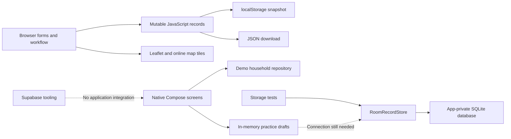

# Tala system analysis — 11 October 2026

> Historical review. Folder organization subsequently repaired the progress JSON and entry-point links. See [follow-up status](../traceability.md). Other application findings remain open.

Tala is a working browser demonstration plus an early native Android rewrite. It is not yet one integrated, durable household enumeration application. The strongest completed parts are the browser workflow and the Android form rules and transactional storage foundation. The immediate delivery priority is connecting native editing to storage, while resolving the confirmed data-integrity problems in the browser reference.

This review covers application source, form definitions, storage, navigation, mapping, tests, configuration, planning artifacts, and recorded device evidence. Existing staged moves and other local edits were present before the review. Application source was not changed. Checks used fictional records in isolated browser profiles. No hosted database inspection, migration, device installation, or phone data modification was performed.

## Components and actual implementation status

| Component | What exists | Current boundary |
|---|---|---|
| `browser/` | Plain JavaScript, schema-driven forms, 18 survey sections, household/member editing, dashboard, photos, signature/consent, callbacks, review, JSON export, Leaflet mapping | Browser-local demonstration; no authentication, import/restore, server persistence, or synchronization |
| `android-native/` | Kotlin, Jetpack Compose, ViewModels/StateFlow, typed navigation IDs, search/filtering, a representative practice form, Room database and transactional record store | MainActivity uses DemoHouseholdRepository. Practice answers remain in memory; the UI does not save to Room |
| `mobile/` | Expo Router starter with Home/Explore example screens | No Tala questionnaire or registry implementation; TypeScript currently fails |
| `supabase/` | CLI configuration, tooling documentation, placeholder migration and seed | No application SQL schema or client connection implemented in the repository; hosted state was not inspected |
| `planning/` | 30-card delivery plan, interactive board, evidence for D01–D05 | Generated board works, but source progress JSON is malformed and cannot regenerate the board |

The native application is version 0.3.0, minimum SDK 26, target/compile SDK 37 in its checked-in configuration. Those values describe the project, not an independently verified release-compatibility claim.

## Confirmed defects and their effects

Priorities describe the impact on the current prototype and development workflow. Planned native functionality is listed separately below.

### 1. High: a stale browser tab silently overwrites newer records

Every `save()` serializes the entire in-memory dataset. `go()` saves even when the user is only navigating. There is no revision check or handling of another tab's storage changes.

Reproduction: open the same saved household in two tabs, change the first tab's phone from `0917-123-4567` to `0999-123-4567`, then open Reports in the second tab. Reloading the first tab shows the older number. Navigation in the stale tab has replaced the newer snapshot. The same mechanism can affect other answers, registrations, and removals.

Fix direction: stop saving on read-only navigation; introduce a storage revision/conflict strategy and propagate external changes. Until then, the browser cannot safely support simultaneous tabs.

Source: [workflow.js, save and navigation](../../browser/workflow.js#L9).

### 2. High: unsuccessful storage writes can report success

`save()` catches storage exceptions but returns no success/failure result. Picture upload continues with `toast('Picture saved.')`, replacing the storage-failure message. This was reproduced by forcing `Storage.setItem` to throw `QuotaExceededError`: the visible result was still “Picture saved.” Other actions also continue after calling `save()` without checking durability.

Fix direction: return an explicit save result, keep unsaved changes identifiable, and show success only after persistence succeeds. Image content and signatures embedded in the same JSON snapshot make quota and serialization costs particularly relevant.

Source: [workflow.js](../../browser/workflow.js#L9), [upload completion](../../browser/workflow.js#L86).

### 3. Medium: valid JSON with an invalid record shape causes a blank application

Startup catches JSON syntax errors but does not validate the decoded schema. A stored `{}` produces `Cannot read properties of undefined (reading '0')` and `data.households is not iterable`, with an empty app container. There is no recovery screen for this case.

Fix direction: validate shape/version before use, preserve rejected content for recovery, and provide an explicit recovery path rather than silently discarding potentially valuable records.

Source: [app.js](../../browser/app.js#L3), [workflow initialization](../../browser/workflow.js#L6).

### 4. Medium: duplicate fields can hold contradictory information

- Full Name remains independently editable alongside First/Middle/Last Name and Extension. The review reproduced `name: "Different Person"` with `firstName: "Alex"` and `lastName: "Reyes"`. Household-head fields have the same dual representation. Name-component edits update the stored display name, but ordinary edits do not refresh the other input's displayed value.
- Social protection has both standalone PhilHealth/4Ps answers and a separate programs multi-select. `Covered by PhilHealth? = No` plus `programs = [PhilHealth]` is accepted as a ready section.
- PhilHealth Member/Dependent is currently stored once per household. It cannot identify which member is insured or dependent in a household with different coverage arrangements.
- Public/Private and SNED/SPED are combined into one exclusive school field. If both school ownership and education program need recording, the current structure cannot capture both.

Fix direction: establish one authoritative name representation, derive aggregate program coverage, and settle household-versus-member scope and school classification before porting the complete questionnaire.

Sources: [forms.js](../../browser/forms.js#L8), [name updates](../../browser/workflow.js#L17), [social protection](../../browser/forms.js#L20).

### 5. Medium: browser validation is weaker than native validation

Direct checks of the browser validation function accepted an impossible date (`2025-02-31`), a non-date callback value (`not-a-date`), and a multi-select value outside its available options. Phone normalization turns `abc09171234567` into a valid-looking number. HTML date controls limit ordinary entry, but persisted/programmatically supplied values still reach these rules.

Native FormRules already provides strict date/time parsing, membership/duplicate/exclusivity validation, and phone normalization that preserves malformed input for correction. That implementation should guide shared acceptance cases; the two platforms currently do not enforce equivalent rules.

Sources: [browser rules](../../browser/workflow.js#L14), [phone formatting](../../browser/workflow.js#L80), [native FormRules](../../android-native/app/src/main/java/ph/tala/registry/domain/form/FormRules.kt).

### 6. Medium: the planning board cannot be rebuilt

`implementation-progress.json` line 5 contains an unescaped quotation mark before `Evidence:`. Both a JSON parse and the actual board-generation command fail at that location. The existing generated HTML still passes its browser checks, so it can conceal the broken source pipeline.

Fix direction: repair the JSON and validate it before board generation; check that the generated board matches its source.

Sources: [progress JSON](../../planning/02-progress/implementation-progress.json#L5), [generator](../../planning/02-progress/build-board.cjs#L156).

### 7. Medium: folder moves broke onboarding instructions and evidence links

The root README still instructs `npm start` and references root-level documents, although package.json is now in `browser/` and documentation is in `docs/`. Planning instructions refer to old `planning/build-board.cjs` and `planning/verify-board.cjs` paths. Native and evidence documentation also retain old `planning/evidence/` locations.

Fix direction: update entry-point instructions and relative links together with the directory reorganization. A new contributor should be able to start the browser, build Android, regenerate the board, and open evidence using the documented commands.

Sources: [root README](../../README.md), [planning README](../../planning/README.md), [native README](../../android-native/README.md).

### 8. Low: malformed URLs can terminate the local preview server

The request handler calls `decodeURIComponent` without exception handling. Invoking it with `/%` throws an uncaught `URIError`. This was reproduced with the handler in an isolated VM, without crashing the running preview. The server binds to localhost, which limits exposure, but one malformed request can still disrupt a demonstration.

Fix direction: reject malformed requests with HTTP 400. The server also serves most non-JS/CSS/HTML assets as `text/plain`; use explicit MIME types if this server is retained beyond a simple preview.

Source: [server.cjs](../../browser/server.cjs#L1).

## Native architecture: strengths and integration work

The native design is a better foundation for the intended phone application. Screens exchange IDs, records flow through repository contracts, UI state is immutable, and validation is separated from Compose. Hidden fields are cleared to a fixed point, and stale picker callbacks cannot restore an answer after its controlling branch is hidden. Member drafts are isolated by household/member identity.

Room has eight entities: households, members, interviews, visits, household answers, member answers, coordinates, and attachments. Composite foreign keys prevent member answers from pointing to a member in another household. Snapshot replacement runs inside a transaction; exceptions report failure without exposing stored answers or paths. Schema export is enabled, and no destructive migration fallback is configured.

The following are integration requirements, not claims that the current read-only preview is malfunctioning:

1. **Connect editing to Room.** MainActivity constructs DemoHouseholdRepository, while FormSessionViewModel stores drafts in StateFlow. No production screen instantiates the record store. Tests proving database durability do not prove that entered interview answers survive process death.
2. **Reconcile identities.** Domain/demo IDs currently include `HH-00452` and `DEMO-SANTOS-1`; the store requires canonical UUIDs and a separate displayCode. Add an explicit mapping and use UUIDs for persistent relationships/navigation, while preserving readable display codes.
3. **Reconcile answer namespaces.** Room identifies answers by interview, section, field, and sometimes member. In-memory drafts are keyed only by scope, with field keys shared across sections. Either namespace drafts by section or enforce and test global field-key uniqueness when all 18 sections are ported.
4. **Define snapshot ownership.** The store deletes/reinserts dependent rows during a complete snapshot save. This is atomic, but a partial or stale snapshot can still remove valid data. Serialize writes or use revision checks and require callers to retain every unaffected section.
5. **Persist intentional order and visit history.** Members and visits are loaded in UUID order. VisitRow has an outcome and optional callback time but no actual visit timestamp. Add chronology/order fields when those workflows are implemented.
6. **Implement attachment lifecycle.** Only metadata/path references exist. Files still need safe creation, finalization, cancellation, cleanup, export/restore, and rollback handling. A database transaction does not make file writes atomic.
7. **Add real migration tests at version 2.** The current migration test rebuilds and reopens version 1; it does not test an upgrade between schema versions. This is correctly described in the test source.

Sources: [MainActivity](../../android-native/app/src/main/java/ph/tala/registry/MainActivity.kt#L23), [FormSessionViewModel](../../android-native/app/src/main/java/ph/tala/registry/ui/form/FormSessionViewModel.kt#L14), [RecordStore](../../android-native/app/src/main/java/ph/tala/registry/data/local/RecordStore.kt), [entities](../../android-native/app/src/main/java/ph/tala/registry/data/local/Entities.kt), [DAO](../../android-native/app/src/main/java/ph/tala/registry/data/local/RegistryDao.kt).

## Requirements coverage

| Requirement area | Browser | Native |
|---|---|---|
| Household/member counts and enumerator data | Implemented, based on saved demo records | Basic household/member/callback counts; fixed demo enumerator |
| Structured names, alias, extension, phone | Implemented; name consistency defect above | First name and phone in practice form only |
| Voter, disability/PWD, Solo Parent ID | Implemented with conditional fields | Full questionnaire not ported |
| Education, SNED/SPED, assistance | Implemented; classification needs clarification | Full questionnaire not ported |
| Employment | Implemented | Representative employment controls and rules |
| Safety, previous city, disaster/evacuation | Implemented; evacuation choices are samples | Full questionnaire not ported |
| Social protection | Implemented; scope/consistency issues above | Full questionnaire not ported |
| Photo/signature, consent/review | Implemented locally | Attachment schema only; UI pending |
| GPS/manual mapping | Implemented, online basemap with coordinate fallback | Coordinate schema only; UI pending |
| Durable save/resume | localStorage, with confirmed failure modes | Room verified in historical tests; editing integration pending |
| Export/restore and reversible archiving | JSON export; no restore; latest deletion undo ends on refresh | Pending |
| Accounts, roles, cloud synchronization | Absent | Explicitly outside the current offline demo scope |

The ambiguous Cash/count notes and unidentified programs remain unresolved. Counts are not hardcoded to 15/30. The map's Cogon working rectangle is approximate and is enforced as a save restriction; official boundaries should replace it before it is treated as a real service-area rule.

## Security, recovery, and scale

The browser keeps answers, pictures, and signatures unencrypted in localStorage and downloads plaintext JSON. It has no user identity or authorization boundary. The native build has no Internet permission, uses app-private Room storage, and intends to disable automatic backup, but has no application encryption or authentication. These match a fictional-data demo; they do not establish readiness for resident data.

The Android extraction rules contain `<exclude domain="root" />` without a path. Android's documentation requires a domain and path for exclusion entries and notes that `allowBackup=false` does not disable device transfers on every manufacturer's device. Treat the no-transfer claim as unverified until explicit rules and an actual backup/transfer check confirm the behavior; this review did not demonstrate a data leak. [Android backup documentation](https://developer.android.com/identity/data/autobackup).

Supabase tooling is not a deployed application backend. Before any future integration, the project needs an ownership/role model, versioned application schema, grants and RLS policies, authenticated client access, and allow/deny tests. Supabase documents grants and row policies as separate controls. No conclusion about the hosted project's current security is possible from the empty local migration. [Supabase RLS documentation](https://supabase.com/docs/guides/database/postgres/row-level-security).

The browser rewrites the complete dataset on ordinary input events, including embedded images, and renders lists without pagination. That is reasonable for small demonstrations but has no measured capacity guarantee. The native repository currently exposes all households as one list; paging/indexed search can be introduced when realistic dataset sizes justify it.

## Verification and limits

| Check | Result in this review |
|---|---|
| Browser syntax (`npm run check` from browser/) | Passed |
| Existing browser workflow suite | All assertions reported passed, including 18 sections, branching, review, signature, persistence and JSON export |
| Existing mapping suite | All assertions reported passed, including location denial/staleness, coordinates, delete/undo and map navigation |
| Existing revision suite | All assertions reported passed, including pictures, PWD branches, names, phone, education and social protection controls |
| Generated planning board suite | All assertions reported passed for the existing HTML |
| Progress JSON parse and board generation | Failed: malformed D01 notes string |
| Expo TypeScript | Failed: missing declarations for animated-icon.module.css and the @/global.css side-effect import |
| Targeted browser failure probes | Reproduced the findings recorded in SYSTEM-ANALYSIS-EVIDENCE.json |
| Native build/unit/lint attempt | Offline retry reached Kotlin compilation and testDebugUnitTest, both UP-TO-DATE; lintAnalyzeDebug did not finish during the review and was interrupted. No fresh unit-test run, completed lint run, or new APK is claimed |
| Android device tests | Historical D03–D05 evidence reviewed; not rerun or installed during this analysis |
| Hosted Supabase security/integration | Not inspected; repository-only assessment |

Browser suites ran through a temporary harness that suppressed screenshot writes so existing evidence images were preserved. Assertions completed, but several Edge teardown processes did not exit promptly and were interrupted after their pass output. Historical native evidence records 18 JVM tests, 8 UI device tests, 6 storage tests, and a version-1 schema check; it remains historical evidence, not a fresh verification result.

## Recommended work order

1. Repair progress JSON and documentation paths so the development baseline is reproducible.
2. Fix browser save-result handling, stale-tab overwrites, shape validation, and duplicate-answer inconsistencies. Turn the reproduced cases into lasting regressions.
3. Complete the native repository adapter and editing-to-Room path, resolving UUID/display-code and section-answer mapping. Prove an entered interview survives process death and failed writes remain recoverable.
4. Port the complete questionnaire using an explicit field/scope/branch/validation matrix, then implement review/signature, attachments, location, export/restore, and archive/restore.
5. Verify schema upgrades, recovery, large records, a second device configuration, and the exact signed release artifact before handover.

The generated board marks five of thirty work packages Done. That is not a measure of product completion: most user-facing native workflows remain ahead. Reassess the September 29–October 28 baseline using remaining work and measured throughput; a Supabase/cloud requirement would add a separate scope beyond the documented offline plan.
