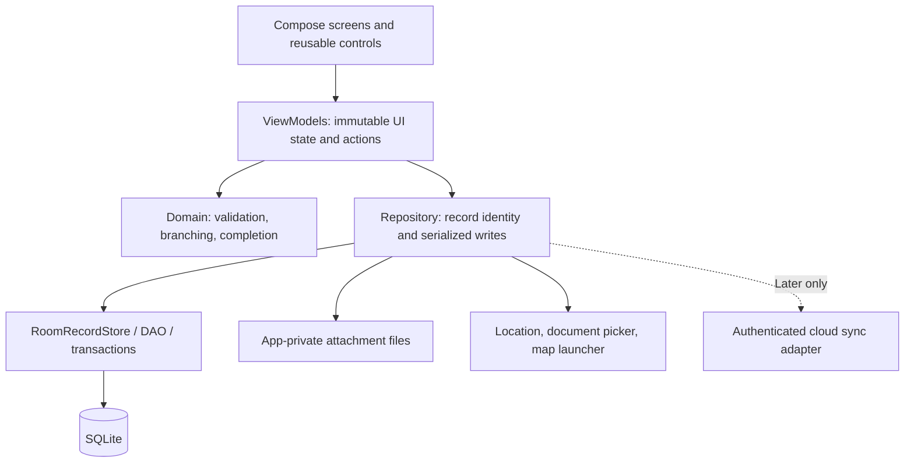

# Technical Requirements Document — Tala

Version 1.0 · 11 October 2026 · Target requirements unless marked current.

## 1. Architecture and constraints

Use one native Android application module with Kotlin, Jetpack Compose and Room. Maintain `ui`, `domain`, and `data` package boundaries. Compose reads immutable state and emits actions; ViewModels invoke repositories; repositories coordinate rules, persistence and external adapters. Keep manual constructor injection initially. This follows Android's recommendations for layered architecture and lifecycle-aware state; it does not require upgrading the pinned navigation library during documentation work. [Android architecture recommendations](https://developer.android.com/topic/architecture/recommendations).

As of the Day 6 card, `MainActivity` opens the Room database and reads and writes through `RoomHouseholdRepository`; the fictional `DemoFixtures` records are seeded once and are explicitly optional. The browser uses globals and localStorage; retain it as a reference and regression surface, not the native storage architecture.

## 2. Technical requirements

| ID | Requirement | Verification |
|---|---|---|
| TR-01 | Native minSdk 26, compile/target 37, JDK 17, pinned Gradle/catalog; offline APK launch | Build with wrapper; airplane-mode cold launch without development server |
| TR-02 | Persistent IDs are UUIDs; readable codes are unique labels, never relational keys or list positions | Reorder/remove a member without changing remaining identities |
| TR-03 | Namespace answers by interview + section + field + optional member; enforce household ownership | Cross-household answer/attachment write is rejected |
| TR-04 | Pure validation handles calendar correctness, integer ranges, phone syntax, option membership and exclusivity | Shared positive/negative fixtures in JVM and browser tests |
| TR-05 | Fixed-point branch cleanup; asynchronous callbacks carry original record/scope and are ignored when stale | Hide a branch while a picker/location request is open |
| TR-06 | One ordered write stream per household; full snapshot saves require base revision and retain unaffected sections | Stale second editor returns Conflict instead of overwriting |
| TR-07 | Save result distinguishes Saved, Failed, Conflict; UI never derives durability from navigation or memory state | Disk/full-write fault leaves previous record intact and shows Unsaved |
| TR-08 | Database operations are transactional and off the UI thread; reads expose Flow | Rollback after mid-write constraint failure restores previous graph |
| TR-09 | Debounce draft persistence by 500ms; explicit Save/Back flushes and awaits result; do not rely only on onStop | Kill immediately after Saved; all acknowledged data returns |
| TR-10 | SavedStateHandle stores small navigation/filter inputs; records are reloaded from Room after process death | Rotation preserves focus/context; fresh process reconstructs durable answers |
| TR-11 | Room schema exports committed; every schema increment has tested migrations, no destructive fallback | Open previous-version fixture and verify all relationships/answers |
| TR-12 | Media is referenced by stable attachment ID/path, stored separately; create temp file, validate, finalize, commit reference; clean orphans safely | Cancel/failure/replacement cannot delete the previous referenced file |
| TR-13 | Validated versioned backups; restore is transactional, conflict-aware and preserves attachments | Unsupported version, duplicate ID, bad hash, truncated file reject with no partial mutation |
| TR-14 | View/read operations never write; browser reference detects cross-tab changes and does not overwrite newer snapshots | Two-tab stale-write regression from system analysis |
| TR-15 | Strict startup data validation with recovery path; preserve rejected original data | Wrong-shape local data shows recoverable error instead of blank UI |
| TR-16 | Archive is persistent soft state; ordinary archive does not cascade-delete children | Archive/restart/restore returns identical graph |
| TR-17 | Private records and secrets do not appear in diagnostics, crash messages, URLs or source control | Test error surfaces and inspect release/log configuration |
| TR-18 | Permission denial, provider timeout and absent map applications have usable manual fallbacks | Complete location and save without location permission or tiles |
| TR-19 | Reusable accessible controls have labels, semantic groups, first-error focus and keyboard-safe layout | Device UI checks with large text and navigation accessibility |
| TR-20 | Release signing key outside Git; verify a signed non-debuggable APK, source revision and SHA-256 | Fresh install and compatible signed upgrade on exact artifact |

500ms debounce and the limits below are proposed engineering acceptance targets, not measured performance claims. Explicit Saved is the durability boundary; a process killed while Saving may retain only the prior committed draft.

## 3. Persistence and concurrency

The existing RoomRecordStore replaces a complete household graph in one transaction. The editing layer must load the full current graph before changing a section. Add a monotonic record revision to support compare-and-swap writes; a mismatch returns Conflict with the latest revision. Resolve by reload/merge under user control, not silent last-writer-wins. A newer record must never be replaced by a stale tab merely opening Reports.

Keep raw editable strings while a form is incomplete. Store validated typed scalar/multi values at the answer boundary; absence represents unanswered. Review is a separate state transition after form validation and successful persistence. Draft autosave does not mark a section complete by itself.

Use the existing version-1 schema as the migration source of truth. The design extensions in [Data Models](03-data-models-and-schemas.md) require a deliberate version increment; no migration is applied by this document. Room provides the local database abstraction and exported schema support. [Room documentation](https://developer.android.com/training/data-storage/room).

## 4. Nonfunctional targets

| Area | Target / method |
|---|---|
| Dataset | Test 1,000 households and 10,000 members with representative answers; test media separately. These are benchmark fixtures, not enforced registry limits |
| Cold start | Home usable within 3 seconds on target phone, p95 over 20 cold launches, airplane mode |
| Search | Result update within 300ms after input settles, p95 over 50 searches in benchmark dataset |
| Save | Text-only household snapshot acknowledged within 1 second, p95 over 50 writes; slow media processing reports progress |
| Images | Input cap 5 MiB per image; JPEG/PNG/WebP accepted; normalize to maximum 1600px longest side and target at most 1 MiB; fail clearly if limits cannot be met |
| Backup | Maximum JSON file 50 MiB; decoded single attachment at most 5 MiB; stream/bound parsing; reject oversized input before mutation |
| Dates | Date-only ISO `YYYY-MM-DD`; event timestamps UTC ISO 8601; callback retains local date/time plus IANA zone, default Asia/Manila |
| Navigation | ID-based destinations; no household data objects in route parameters; missing/archived records have explicit state |
| UI | Native touch targets ≥48dp; 200% font scale, portrait/landscape and small phone smoke checks; no input hidden by keyboard |
| Compatibility | Target device plus second API/size configuration; no universal-device compatibility claim from one phone |

## 5. Security and data lifecycle

Offline capstone uses fictional data. Current localStorage and Room implementations have no application-level encryption or authentication. Before resident-data use, require an explicit deployment threat model, authorized user access, encryption/key management, approved consent/retention, lost-device handling, and audit requirements. These are future release requirements, not implemented controls.

Disable unintended OS backup/transfer using explicit tested rules with domain and path; do not assume the manifest flag alone blocks every transfer mechanism. Keep generated exports user-selected and make their plaintext content clear. Production exports need a separately approved protection/recovery policy. [Android backup rules](https://developer.android.com/identity/data/autobackup).

No direct database credentials or service-role secrets in clients. Future exposed Supabase tables require explicit grants, RLS and allow/deny tests. A signed-in user is not automatically authorized to every household. [Supabase RLS](https://supabase.com/docs/guides/database/postgres/row-level-security).

## 6. Test and delivery gates

- JVM: form rules, scope isolation, completion, ID mapping, revision conflicts, backup validation.
- Room device tests: reopen, transactions, FK constraints, concurrent edits, migration, archiving and file references.
- Compose device tests: every section, roster switching, keyboard, back navigation, process recreation, first-error focus, permission denial and unsaved changes.
- Browser: reference workflows plus corruption, failed-write and cross-tab regressions; do not treat browser tests as native acceptance.
- Backup: golden fixture plus malformed, unsupported, conflicting, corrupted-media and interrupted-restore cases.
- Release: lint, build, tests, signed APK identity/hash, install/upgrade, offline full interview and exact-artifact smoke test.

The prior review observed browser assertions passing, Expo type errors, and an incomplete fresh native lint run. Those observations are in the [dated analysis](../reviews/SYSTEM-ANALYSIS.md); they are not acceptance of these new targets.

## 7. Change control

Keep requirement IDs stable. Changes to field meaning/scope/options require a questionnaire version and migration decision; changes to backup structure require a format-version decision. Database schema, backup format and questionnaire version are separate numbers. Update traceability, tests, documentation and evidence in the same change. Cloud, payment, and third-party SDK additions require an explicit scope/dependency decision before implementation.
