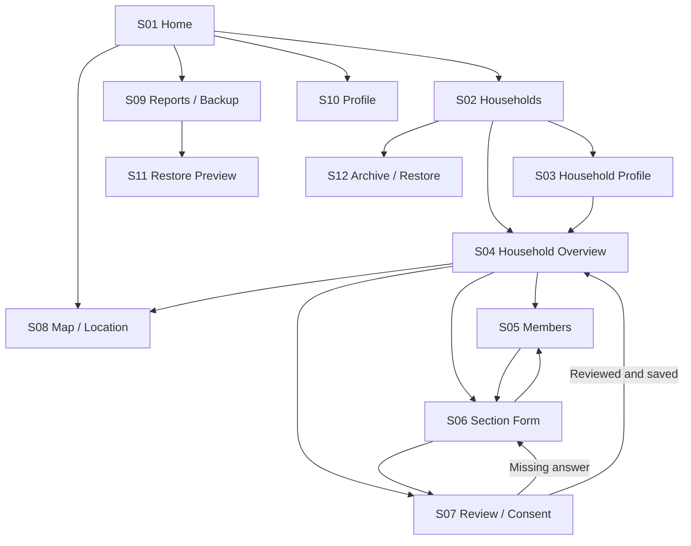
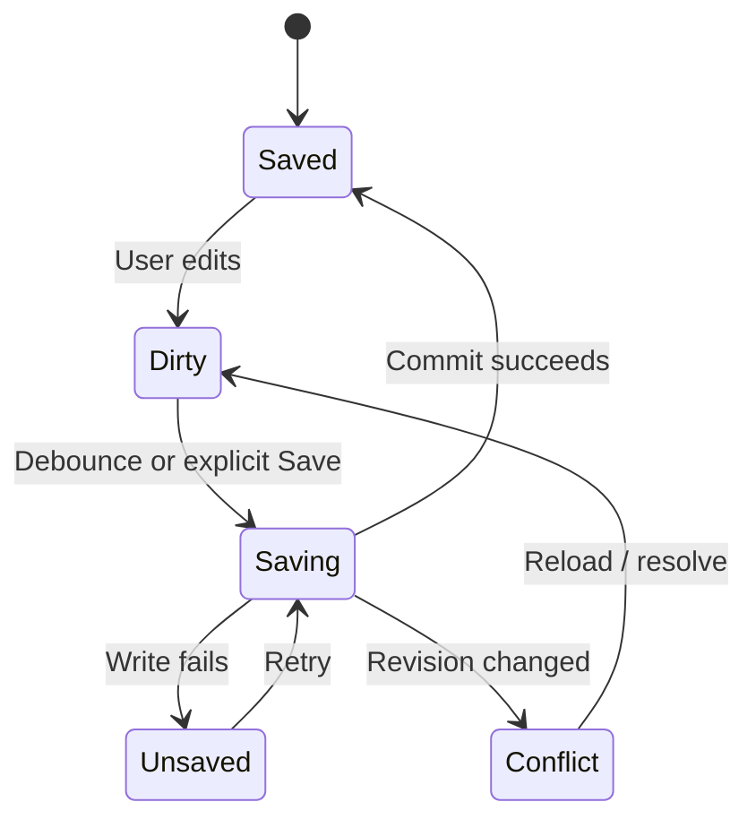

# User Flows & Wireframes — Tala

Version 1.0 · 11 October 2026 · Proposed complete native release navigation.

Open the [wireframe gallery](../design/wireframes.html) for linked grayscale layouts. They describe the target workflow, not the currently implemented native screens. All names and values are fictional. Screen IDs below connect to requirement IDs in the [traceability matrix](../traceability.md).

## 1. Navigation model

Top-level destinations: Home, Households, Map, Reports, Profile. Within a household: Overview, Members, Sections, Review. Each destination receives the household UUID and optional member UUID; display codes are labels. Android Back returns to the prior destination while preserving the same record context.

## 2. Primary journey: register and finish

1. S01: enumerator verifies profile and opens Register Household.
2. S03: enter head components, address and respondent; Save Draft creates the stable household identity. On failure, remain on the form with entered values.
3. S04: show draft status and 18-section checklist. Completion reflects current required answers, not merely pages visited.
4. S05: add members; choose a member to enter demographics, other demographics, migration, education and employment. Switcher shows the same member until deliberately changed.
5. S06: complete household sections; branches reveal dependent questions. Save Draft allows missing answers; Save & Continue validates visible required fields, persists, then navigates.
6. S07: present notice, record consent and signature/typed name. Review incomplete items by selecting their row.
7. S07: enable Finish Review only when every applicable question and signature rule passes. Show success only after the reviewed snapshot is saved.

## 3. Alternate journeys

| Flow | Steps | Expected recovery |
|---|---|---|
| Resume | Home→Households→search/filter→Overview→Continue Interview | First incomplete section for the selected record; already saved answers restored |
| Callback | Visit Information→Callback→local appointment→Save→Callback filter | Keep earlier visits; due reminder is a local display requirement, not a push notification service |
| Refusal | Notice→No→return to draft/record refusal | Clear signature; do not force completion or mark Reviewed |
| Disability | Member→Other Demographics→Has Disability Yes→Registered PWD Yes→ID | Switching either parent to No removes now-hidden answers |
| Location denied | Location→Use Device Location→permission denied→manual coordinates→confirm→save | Permission denial does not block interview or manual entry |
| Map unavailable | Map tiles fail→show status and saved coordinates/list | Retry or external map link; no empty blocking screen |
| Save failure | Edit→Save→write fails | Keep editable state and prior saved snapshot; show Retry; no success toast |
| Conflict | Edit old revision→Save→Conflict | Explain newer record exists; offer reload or deliberate merge; no silent replacement |
| Archive | Overview→Archive→confirm→Archived list | Counts update; restart and restore returns same graph |
| Export | Reports→scope→Export→system file destination | Cancel is neutral; show exported only after the destination write completes |
| Restore | Reports→choose backup→validate→S11 conflict preview→confirm→apply | Cancel/error leaves records unchanged; success states imported/skipped/replaced counts |

## 4. Screen contracts

| Screen | Layout skeleton / primary controls | Empty/error/loading states |
|---|---|---|
| S01 Home | Header/profile; registered/member/sex counts; enumerator card; continue list; Register Household; bottom navigation | No records: registration prompt; counts zero. Loading placeholder must not appear as a final zero count |
| S02 Households | Search; status chips; cards with head/code/address/status; Register; Archived filter | No match: clear filters. Database error: retry and backup/recovery guidance |
| S03 Household Profile | Back and code; structured name; address/respondent; phone; safety/reason; photo; Save Draft / Save & Continue | Inline first-error focus; Unsaved banner with retry; upload cancellation preserves old picture |
| S04 Overview | Head/code/status; saved indicator; section completion; Members/Sections/Review/Location; archive action | Missing record: return to list. Archived: restore action and read-only state |
| S05 Members | Household context; member count; ordered member cards; Add Member; removal confirmation | Zero members: Add First Member; prohibit review but allow household draft |
| S06 Section Form | Household/member switcher; section title/progress; questions; branch region; fixed bottom actions | Optional labels; first error scrolled into view; scroll/focus preserved during ordinary edits |
| S07 Review / Consent | Section status list; notice link; Yes/No; signature/typed alternative; Finish Review | Missing links jump to exact scope; refusal blocks Reviewed without erasing unrelated answers |
| S08 Location / Map | Map panel; permission/capture; lat/lng; source/accuracy/time; confirmation; save; external directions | Offline panel preserves coordinate fields; unconfirmed point cannot be saved as verified |
| S09 Reports / Backup | Counts/status summary; record scope; Export; Restore; archived count | No data: disable empty export or explain empty backup; destination failure supports retry |
| S10 Profile | Enumerator name; barangay; picture; save; demo/about | Blank required name fails; existing attribution on old records remains unchanged |
| S11 Restore Preview | Backup version/date; household/member/media counts; conflicts; Keep Existing/Replace selections; Apply/Cancel | Unsupported/corrupt file shows reason before any change; blocked conflicts require explicit choice |
| S12 Archive / Restore | Record identity; effect on counts; confirm archive or restore; cancel | Archive failure stays active and visible; success persists beyond restart |

## 5. Save and review state machines

Record workflow is separate: NotStarted→InProgress; visit outcome may set Callback; all requirements + consent/signature + commit allow Reviewed. Any content edit invalidates Reviewed. Archive is an orthogonal timestamp/state, not deletion or a fifth mutually exclusive interview outcome.

Back while saving waits for the pending write. Back with an unsaved failure offers Stay/Retry or Discard Unsaved Changes; the latter returns to the last durable snapshot. Force-kill recovery returns acknowledged saves; no promise is made for uncommitted edits.

## 6. Presentation rules

Use consistent initial capitals/sentence case; preserve acronyms PWD, SNED, SPED, DSWD and PhilHealth. Distinguish required fields from explicitly Optional ones. Yes/No starts unanswered. Do not encode state only through color. Pair errors with the question they concern. Keep the active member and household visible on long forms. Phone display uses 4-3-4 formatting. Wireframes are neutral layout guidance, not branding or an accessibility certification.
