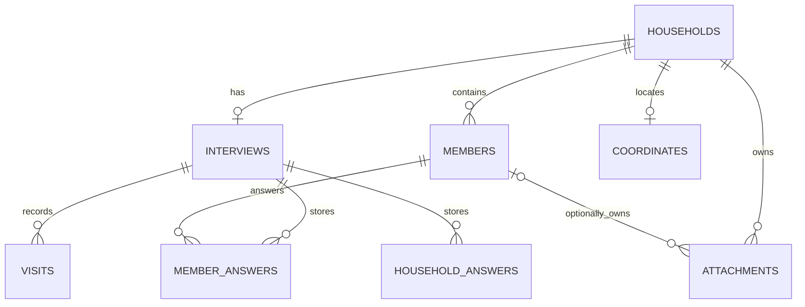

# Data Models & Schemas — Tala

Updated 24 October 2026. **Current** means checked-in Room version 5. **Target** means a design proposal requiring implementation/migration. No database is modified by this specification.

## 1. Sources of truth

- Current entities: [Entities.kt](../../../android-native/app/src/main/java/ph/tala/registry/data/local/Entities.kt).
- Authoritative exported Room schema: [version 5 JSON](../../../android-native/app/schemas/ph.tala.registry.data.local.RegistryDatabase/5.json); [versions 1–4](../../../android-native/app/schemas/ph.tala.registry.data.local.RegistryDatabase/4.json) remain migration fixtures.
- Readable generated historical DDL snapshot: [room-v1.sql](../schemas/room-v1.sql). Documentation only; do not apply as a Supabase migration or treat it as the latest Room schema.
- Current questionnaire: [field dictionary](../schemas/questionnaire-field-dictionary.md), [machine-readable inventory](../schemas/questionnaire-current.json), generated from browser/forms.js.
- Current portable format: [backup-v1.schema.json](../schemas/backup-v1.schema.json), [fictional example](../schemas/backup-v1.example.json). Reports exports and restores this format.

## 2. Current entity relationships

One interview per household is enforced by a unique householdId index. The store expects an interview when loading a complete snapshot, although the household row can exist independently at the SQL level. Multiple visits belong to that interview. A future repeated census cycle needs a deliberate change to interview uniqueness; it is not supported by silently adding another interview now.

## 3. Current Room version-4 dictionary

All String columns use SQLite TEXT; Double uses REAL; Long uses INTEGER. Fields are non-null unless suffixed `?` below. UUID validation is performed by RoomRecordStore, not a SQL UUID column type.

| Table | Fields | Keys / relationships |
|---|---|---|
| households | id:String; displayCode:String; headName:String; address:String; status:String; archivedAt:Long? | PK id; unique displayCode. Store permits NotStarted, InProgress, Callback, Reviewed; archivedAt is null on active records and set when a record is archived. Migration 1 → 2 adds this column with `ALTER TABLE households ADD COLUMN archivedAt INTEGER` and keeps every existing row active |
| members | id:String; householdId:String; displayName:String; sortOrder:Int | PK id; FK householdId→households.id CASCADE; household index; unique (id,householdId). Migration 3→4 assigns existing members a deterministic order and new snapshot saves persist the visible roster order |
| interviews | id:String; householdId:String; questionnaireVersion:String | PK id; unique householdId; FK→households CASCADE; unique (id,householdId). Kotlin default practice-v1 |
| visits | id:String; interviewId:String; outcome:String; callbackAt:String?; visitedOn:String; notes:String; recordedAt:Long | PK id; FK→interviews CASCADE; interview index. Migration 2→3 preserves existing rows and adds blank date/notes and zero recordedAt defaults. Explicit visit actions append entries ordered by recordedAt then id; callback appointment is local date/time with no explicit zone column |
| household_answers | interviewId:String; section:String; field:String; kind:String; value:String | PK (interviewId,section,field); FK→interviews CASCADE |
| member_answers | interviewId:String; householdId:String; memberId:String; section:String; field:String; kind:String; value:String | PK (interviewId,memberId,section,field); composite FKs ensure interview and member belong to householdId; both FK pairs indexed |
| coordinates | householdId:String; latitude:Double; longitude:Double; accuracyMetres:Double?; capturedAt:Long | PK/FK householdId→households CASCADE; store validates latitude ±90, longitude ±180, finite nonnegative accuracy |
| attachments | id:String; householdId:String; memberId:String?; kind:String; relativePath:String; mimeType:String | PK id; household FK and optional composite member FK CASCADE; path validated as attachments/name.extension; PhotoStore stages private JPEG pictures and PNG signatures before committing references, then removes old files and recovers unreferenced copies |

Kotlin constructor defaults are not necessarily SQL DEFAULT clauses. Use the exported schema when constructing SQL fixtures. Current save replaces the household's complete child graph transactionally; partial snapshots are unsafe unless merged before save.

D15 reuses the existing coordinate table, without a schema increment. New coordinate
writes validate finite bounds, finite nonnegative measured accuracy and a positive
capture timestamp. Device fixes preserve their original measured accuracy and fix
time. Manual entries have null accuracy and use their entry time; the current domain
model infers manual/unmeasured versus device provenance from accuracy nullability.
This convention adds no source column and does not reconstruct unknown legacy
provenance. Legacy rows remain intact during unrelated full-snapshot writes.
Coordinate writes load the latest household under the repository write mutex,
preserve its graph and refuse archived households. The native location workflow's
verification status is recorded in [D15 evidence](../../03-evidence/D15.md).

## 4. Answer encoding and identity

Current AnswerCodec encodes `Scalar("Yes")` as kind=`scalar`, value=`"Yes"` (a JSON string), and Multi values as a JSON array string. Text, dates, numbers and choices are currently scalar strings; questionnaire validation supplies meaning. Absence means unanswered. Blank scalar is treated as unanswered; No is a real answered value.

Target in-memory key is `(interviewId, sectionKey, fieldKey, memberId?)`. Household answers omit memberId. Reject a supplied memberId that belongs to a different household. Field keys are stable machine identifiers; labels may be reformatted without changing keys. Do not use display names or roster indices as identity.

In the proposed portable model, member name components live on the member object, and displayName is a derived convenience value that must match those components. Do not duplicate name/extension/alias fields in its generic answers array. A form renderer binds those structural fields to the member object; remaining demographics, such as registeredVoter, remain scoped answers. The current browser inventory has not yet made this normalization.

Current native demo identifiers such as HH-00452 are readable placeholders. Target persistent identity is UUID with displayCode kept separately. A migration from browser data must generate and retain an explicit old-ID→UUID mapping, including member identities that currently only have array positions. Never infer member identity from a name match.

## 5. Target schema extensions — not yet migrated

| Entity | Proposed fields / change | Purpose |
|---|---|---|
| Household | revision:Long; createdAt/updatedAt:UTC timestamp | Optimistic concurrency and history boundary; archivedAt is already implemented |
| Member | firstName/middleName/lastName/extension/alias | One authoritative name; `sortOrder` and stable user-visible roster order are already implemented, while displayName remains stored rather than derived |
| Household head | headMemberId:nullable member FK in same household, plus provisional head name before roster | Avoid two independent identities; confirm respondent versus head semantics |
| Interview | consent:Unanswered/Yes/No; signedName?; signatureAttachmentId?; reviewedAt?; reviewedRevision? | Review tied to acknowledged record content; no duplicate signature source |
| Visit | visitedAt:timestamp; callbackTimeZone?; enumerator attribution | Extend current dated history/local appointments with time-zone and attribution metadata; notes and recording order are already implemented |
| Coordinate | source:device/manual; confirmedAt; addressAtCapture; notes? | Preserve capture provenance and detect address changes |
| Attachment | byteSize; sha256; createdAt; source; lifecycle state | Integrity, backup, orphan cleanup and file/database reconciliation |
| Enumerator profile | local profile ID; name; barangay code/label; photo reference | Local workspace configuration; separate from authenticated cloud identity |
| Reference catalogs | catalog ID/version plus barangay/evacuation items | Replace samples without changing existing historical labels silently |

Remaining extensions require a later Room migration and preservation tests. DEC-02 (social-protection scope) and DEC-03 (school classification) must be resolved before changing answer meanings. Keep older questionnaire versions readable.

## 6. Portable backup contract

The implemented offline format uses UTF-8 JSON, format=`tala-backup`, formatVersion=`1`, exportedAt UTC, prototype=true, and a records array. Each household is a full graph with members, interview, visits, scoped answers, optional location and embedded attachments. IDs remain UUIDs and pictures/signatures travel with the record as base64 content plus MIME type, byte size and SHA-256. The portable answer objects carry scalar/multi values directly, not the database's doubly encoded JSON strings.

D17 amendment: the contract contains only what the native record store persists. Record `revision`/`createdAt`/`updatedAt`, member name parts, interview `reviewedAt`/`reviewedRevision`, and location `confirmedAt`/`addressAtCapture`/`notes` were removed rather than synthesized; visits carry `visitedOn` (form-entered date) plus `recordedAt` (append order) instead of one timestamp, and member `sortOrder` comes from the persisted roster order. Export-side limits: an attachment whose file is missing, empty, or over 5 MiB is skipped and counted in the saved summary. The JSON is encoded to a size-limited staging file, then copied to the selected destination only after the complete document is valid and at most 50 MiB; attachment bytes and the final JSON are not retained together in memory. The review timestamp is not tracked natively; a reviewed household exports status `Reviewed` with no fabricated date.

Implemented restore sequence:

1. Enforce 50 MiB file cap before parsing; reject unsupported format/version and wrong primitive types.
2. Stream the bounded file into the strict versioned decoder and validate semantic invariants, including globally unique per-table identities and consistency of derived consent/signature summaries. Decode bounded attachments to app-private staging and verify size, SHA-256, MIME type and actual image format.
3. Show household, attachment and matching-ID replacement counts. Refuse display-code collisions owned by another UUID; matching UUIDs are visibly replaced after confirmation.
4. Stage media, transactionally replace all complete selected graphs, then best-effort delete superseded files. Database failure removes newly staged files and preserves prior records.
5. Restrict answers to the current questionnaire and correct scope, clear hidden dependents to a fixed point, and downgrade an incomplete imported Reviewed record to InProgress.

Semantic invariants that JSON Schema alone cannot establish: unique IDs across records; unique displayCode; unique section/field/member answer key; member ownership; attachment reference existence; head/signature/profile reference scope; field membership in questionnaire version; hidden-answer cleanup; strict calendar dates; actual base64 decode size; content hash. The example uses an incomplete draft intentionally.

Browser `exportData` currently emits `{exportedAt, prototype, households}` without this versioned format and without stable member IDs. Treat it as a separate legacy import source requiring a converter, never as backup-v1 automatically.

## 7. Current cloud boundary

The optional Supabase integration stores owner-scoped full snapshots plus private attachment objects. Room remains the source of truth. A durable Room outbox retries selected uploads, and acknowledged per-owner revisions prevent ordinary retries from overwriting a newer cloud snapshot. Deliberate local-wins replacement requires separate user confirmation. Keep database privileges and RLS policies in versioned migrations.

Cloud download/merge, assignment authority, multi-role administration, retention, tombstones and audit history remain outside the current implementation. Exposed relations require both grants and row-level policies. [Supabase RLS](https://supabase.com/docs/guides/database/postgres/row-level-security), [PostgreSQL constraints](https://www.postgresql.org/docs/current/ddl-constraints.html).

## 8. Migration acceptance

Start with the exported v1 fixture, migrate to the chosen next version, and verify every household/member/answer/visit/coordinate/attachment survives. Test foreign-key failures, rollback, archive/restore, duplicate IDs, altered display names, existing reviewed records, and interrupted media migration. Keep schema, questionnaire and portable format versions independent.
